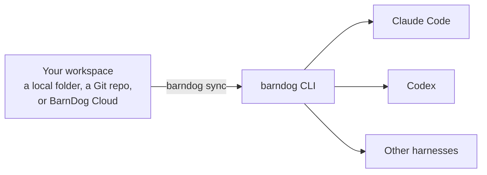

# BarnDog CLI

Set up your AI coding environment once, and have it show up in Claude Code, Codex, or any other harness you love.

`barndog` is the command-line tool for [BarnDog](https://barndog.dev). It installs Skills, MCP servers, Hooks, and knowledge into the coding agents you already use, keeps them up to date, and lets you improve them like code. It works the same whether it's just you, a small team, or a whole organization; only where the assets live changes.

Currently supported harnesses:

- Claude Code
- Codex
- Cursor
- OpenCode (Skills, MCP servers and knowledge; it has no command hooks, so Hooks don't apply)

## Why

Every coding agent has its own place for skills, its own MCP config format, and its own hook settings. Keeping one setup consistent across them, or across a team, usually means copying files around and hoping nobody's copy is stale.

BarnDog keeps one setup and writes it into each tool in that tool's own format. You keep working in the agent you prefer.

## Pick your setup

| Workspace          | Run                         | Best for                                     | What you get                                                                                                                                    |
| ------------------ | --------------------------- | -------------------------------------------- | ----------------------------------------------------------------------------------------------------------------------------------------------- |
| **Local folder**   | `barndog init --local`      | Just you                                     | One copy of your assets in every tool. No account, nothing shared.                                                                              |
| **Git repository** | `barndog init --repo <url>` | Teams that want full control over their data | BarnDog stores nothing. You edit `barndog.yaml` and the folders by hand, and the repository's permissions decide who can change what.           |
| **BarnDog Cloud**  | `barndog init`              | Teams of any size                            | A web catalog to manage, distribute, and discover assets, teams and people; per-team approval rules, and review in the terminal or the browser. |

Git trades discoverability for governance: there are no per-team approval rules, people management or web catalog, and a growing setup can get heavy to maintain by hand. BarnDog Cloud is free during the beta, and will stay free for teams of up to 5 people.

Installing and syncing work the same everywhere. Knowledge needs Git or Cloud. Switch later with `barndog local move` or `barndog migrate --to <server>`.

## How it works



1. **Connect to a workspace.** `barndog init` points at a local folder, a Git repository, or a BarnDog server.
2. **Choose what you want.** Pick your coding tools, then what to install. On BarnDog Cloud that means sets (the organization, your team, the repositories you work in) plus any individual assets.
3. **Sync.** `barndog sync` writes everything into each tool's native location. It runs again automatically when a coding session starts, so updates arrive without anyone thinking about it.
4. **Improve.** Edit a local asset directly, or, in a Git or Cloud workspace, pull it into a folder, edit it, and `barndog push` it for review. Once merged, everyone gets the new version on their next sync.

## What it manages

| Asset          | What it is                                                                                  |
| -------------- | ------------------------------------------------------------------------------------------- |
| **Skill**      | A folder with a `SKILL.md` and supporting files that agents load when relevant.             |
| **MCP server** | A connection to an MCP server. It names the secrets it needs but never stores their values. |
| **Hook**       | A command that runs on an agent lifecycle event, such as after a file edit.                 |
| **Knowledge**  | Policies and context that agents can look up when a task needs it (Git and Cloud).          |

## Install

Runs on **macOS, Linux, and Windows** with [Node.js](https://nodejs.org) 24 or newer.

```sh
npm install -g barndog
```

## Quick start

```sh
barndog init                                     # choose a workspace and your coding tools
barndog status                                   # what's installed on this machine, and where
barndog skills install https://github.com/...    # add one asset
barndog skills search review                     # browse what the workspace offers
barndog sync                                     # apply changes now
barndog doctor                                   # check everything and print a fix for each problem
```

Run `barndog` on its own to see every command, or `barndog <command> --help` for its options.

### Suggest a change (Git and Cloud)

```sh
barndog skills pull code-review --origin team/engineering
cd code-review
# edit SKILL.md
barndog diff
barndog push --title "Add a security checklist"
```

In a Git workspace this opens a pull request on your Git host. In BarnDog Cloud it creates a Suggested Change that reviewers handle with `barndog skills changes list`, `changes diff`, and `changes approve` (or the same under `barndog hooks`), or in the web workspace.

## What it changes on your machine

BarnDog is careful with your existing setup:

- It only touches what it installed itself. It never takes over a skill, MCP entry, or hook you added by hand, and it stops before overwriting anything it doesn't own.
- Comments and unrelated settings in your tools' config files are left alone.
- Its own files live in `~/.barndog/`. Skills appear as links in each tool's skills folder, such as `~/.claude/skills/`.
- Changes are journaled before they're applied, so an interrupted sync is finished safely on the next run.
- Hook scripts run only inside your coding tools, after their own trust checks. Installing or syncing never runs them.

## Documentation

- [What is BarnDog?](https://barndog.dev/docs)
- [Quickstart](https://barndog.dev/docs/quickstart)
- [Core concepts](https://barndog.dev/docs/concepts)
- [CLI reference](https://barndog.dev/docs/cli)

## Contributing

Issues and pull requests are welcome. To work on the CLI:

```sh
pnpm install
pnpm build
npm link        # use your local build as `barndog`
pnpm test
```

[AGENTS.md](AGENTS.md) describes how the code is organized and how each part is expected to behave. It's written for coding agents, and it's the best technical reference for people too.

## License

[MIT](LICENSE)
