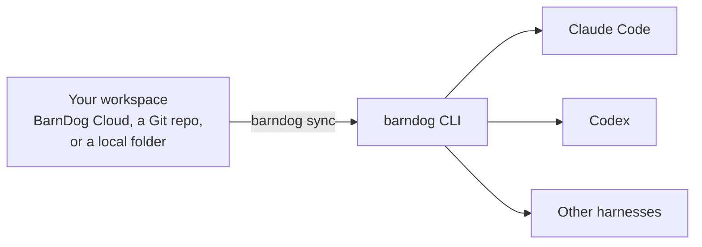

# BarnDog CLI

Set up your and your team's AI coding environment once, and have it show up in every developer's Claude Code, Codex, or any other coding harness.

`barndog` is the command-line tool for [BarnDog](https://barndog.dev). It installs your organization's shared Skills, MCP servers, Hooks, and knowledge into the coding agents your developers already use, keeps them up to date, and lets the team improve them together with review, like code.

Currently supported harnesses:

- Claude Code
- Codex
- Cursor

## Why

Every coding agent has its own place for skills, its own MCP config format, and its own hook settings. Keeping a team's setup consistent across them usually means copying files around and hoping nobody's copy is stale.

BarnDog keeps one shared setup and writes it into each tool in that tool's own format. Developers keep working in the agent they prefer.

## How it works



1. **Connect to a workspace.** `barndog init` signs you in to a BarnDog server, or points at a Git repository or local folder that holds your or your team's assets.
2. **Choose what you want.** Pick your coding tools, then the sets you need: the whole organization, your team, the repositories you work in, plus any individual assets.
3. **Sync.** `barndog sync` writes everything into each tool's native location. It runs again automatically when a coding session starts, so updates arrive without anyone thinking about it.
4. **Improve together.** Pull an asset into a folder, edit it, and `barndog push` a Suggested Change. Teammates review it line by line, and once it's merged everyone gets the new version on their next sync.

## What it manages

| Asset          | What it is                                                                                  |
| -------------- | ------------------------------------------------------------------------------------------- |
| **Skill**      | A folder with a `SKILL.md` and supporting files that agents load when relevant.             |
| **MCP server** | A connection to an MCP server. It names the secrets it needs but never stores their values. |
| **Hook**       | A command that runs on an agent lifecycle event, such as after a file edit.                 |
| **Knowledge**  | Company policies and context that agents can look up when a task needs it.                  |

## Install

Requires [Node.js](https://nodejs.org) 24 or newer.

```sh
npm install -g barndog
```

## Quick start

```sh
barndog init                       # connect, optionally sign in, choose tools and sets
barndog status                     # what's installed on this machine, and where
barndog skills search review       # browse the shared catalog
barndog skills install code-review # add one asset on top of your sets
barndog sync                       # apply changes now
barndog doctor                     # check everything and print a fix for each problem
```

Run `barndog` on its own to see every command, or `barndog <command> --help` for its options.

### No BarnDog server? Use Git

You can share assets through any Git repository, using your own Git credentials. This requires the [GitHub CLI](https://cli.github.com) (`gh`) to be installed:

```sh
barndog init --repo git@github.com:acme/ai-setup.git
```

Or keep them in a folder on your machine with `barndog init --local`. See [Git workspaces](https://barndog.dev/docs/cli/git-workspaces#local-workspaces) for the layout.

### Suggest a change

```sh
barndog skills pull code-review --origin team/engineering
cd code-review
# edit SKILL.md
barndog diff
barndog push --title "Add a security checklist"
```

Reviewers use `barndog changes list`, `changes diff`, and `changes approve` from the terminal, or GitHub repo, or the BarnDog web workspace.

## What it changes on your machine

BarnDog is careful with your existing setup:

- It only touches what it installed itself. It never takes over a skill, MCP entry, or hook you added by hand, and it stops before overwriting anything it doesn't own.
- Comments and unrelated settings in your tools' config files are left alone.
- Its own files live in `~/.barndog/`. Skills appear as links in each tool's skills folder, such as `~/.claude/skills/`.
- Changes are journaled before they're applied, so an interrupted sync is finished safely on the next run.
- Hook scripts run only inside your coding tools, after their own trust checks. Installing or syncing never runs them.

## Documentation

- [What is BarnDog?](https://barndog.dev/docs)
- [Quickstart](https://barndog.dev/docs/quickstart)
- [Core concepts](https://barndog.dev/docs/concepts)
- [CLI reference](https://barndog.dev/docs/cli)

## Contributing

Issues and pull requests are welcome. To work on the CLI:

```sh
pnpm install
pnpm build
npm link        # use your local build as `barndog`
pnpm test
```

[AGENTS.md](AGENTS.md) describes how the code is organized and how each part is expected to behave. It's written for coding agents, and it's the best technical reference for people too.

## License

[MIT](LICENSE)
